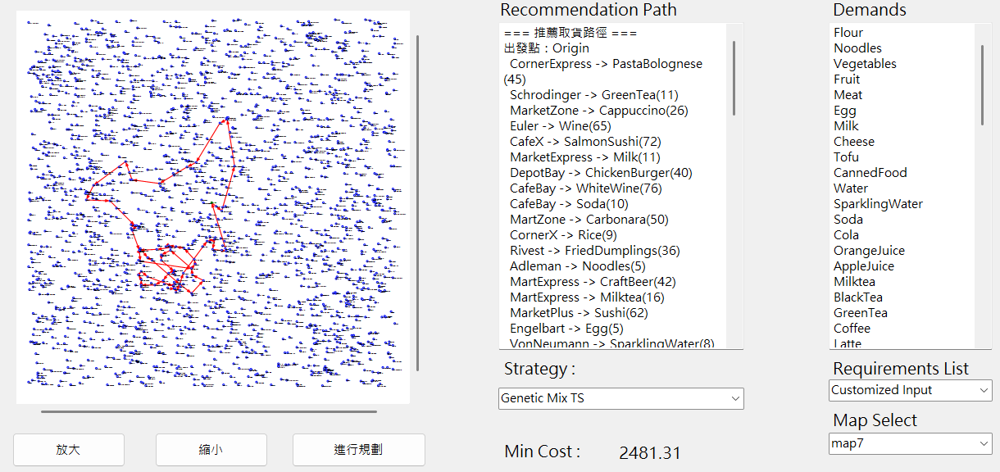
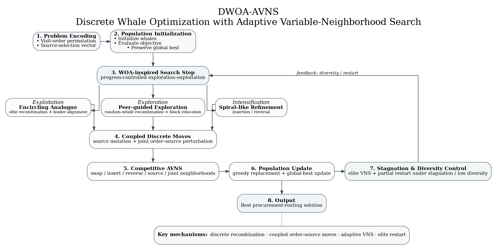
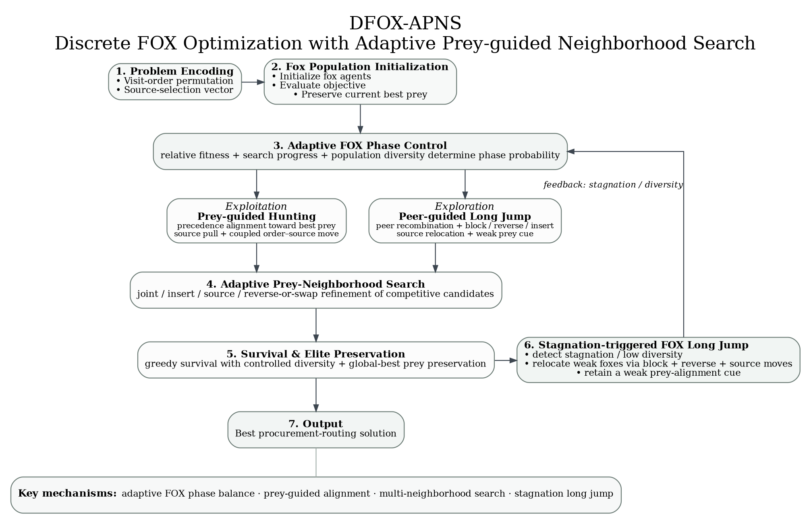
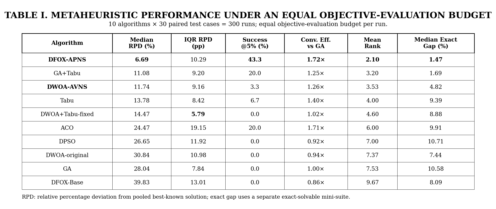
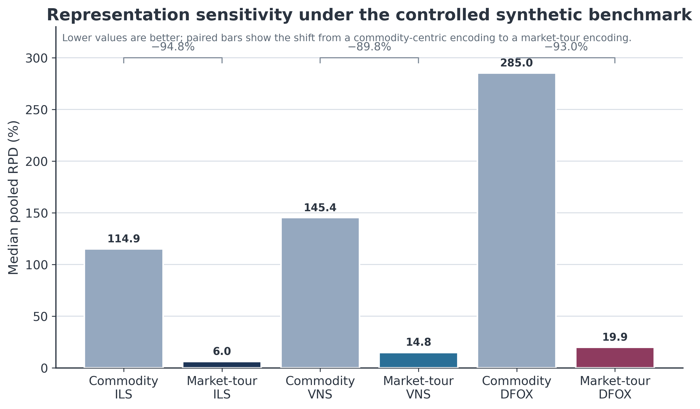
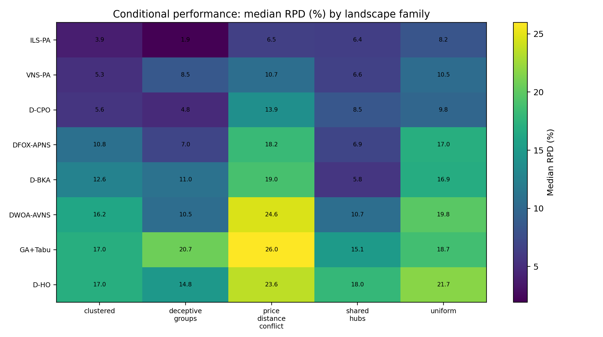
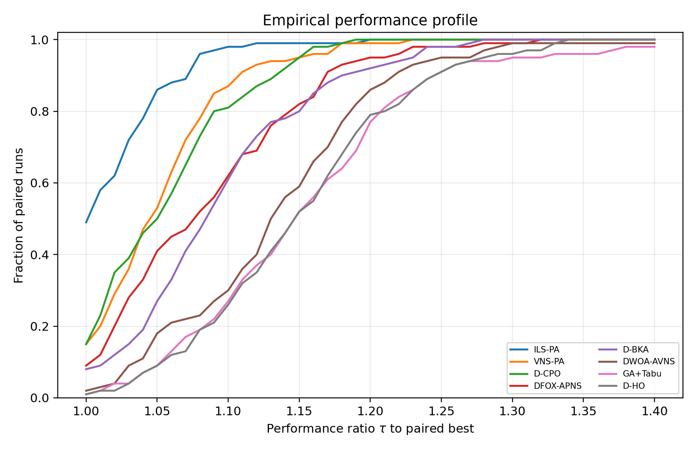
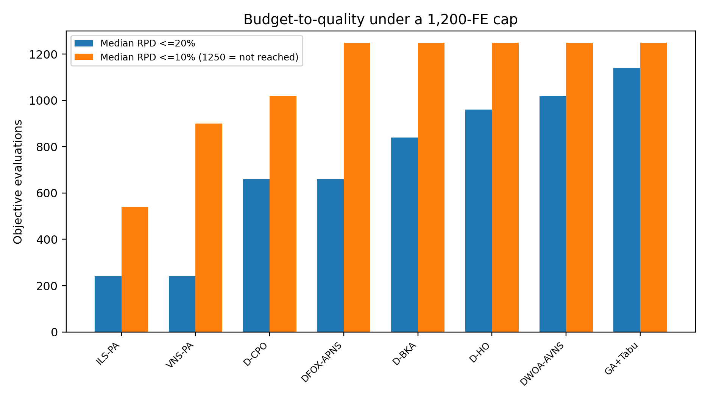

# PANCAKE: Pathfinding for Acquisition of Necessary Commodities using Algorithmic Knowledge Efficiently — Representation, Neighborhood Semantics, and Metaheuristic Mechanism Transfer in the Traveling Purchaser Problem

**PANCAKE** (*Pathfinding for Acquisition of Necessary Commodities using Algorithmic Knowledge Efficiently*) is retained as the repository and software-project identity. The research manuscript is now treated independently under the working title **“Representation, Neighborhood Semantics, and Metaheuristic Mechanism Transfer in the Traveling Purchaser Problem.”** The project is being progressively de-branded at the scientific layer: paper terminology, benchmark descriptions, figures, and claims use problem- and mechanism-oriented names, while the PANCAKE name is preserved only where it identifies the repository, legacy GUI, or historical implementation lineage. The original PANCAKE formulation contains two coupled decisions: a commodity visit permutation and one selected source for every commodity. Its scalarized objective is

\[
f(x)=C_{purchase}+\lambda D_{travel},\qquad \lambda=0.25.
\]

The current research direction is deliberately broader than FOX or WOA. It compares **trajectory/local-search methods (ILS, VNS, Tabu), evolutionary/hybrid methods (GA, GA+Tabu), established swarm transfers (WOA, FOX), and recent metaheuristics (CPO, BKA, HO)** at the level of their actual search mechanisms. FOX remains an important case study because it has a complete controlled ablation and representation analysis, but it is **not treated as the central optimizer of the paper**. The broader question is which mechanisms—problem-aware neighborhoods, leader guidance, heavy-tail perturbation, multi-stage switching, population control, memory/diversity, and adaptive operator selection—remain useful after discretization.

## Current Research Status

PANCAKE has progressed from a route-planning demonstration into a **structure-aware discrete optimization study** with three connected experimental layers:

1. **Legacy commodity-centric benchmark** — preserves the original product-order/source-selection formulation and the 10-algorithm 300-run study.
2. **Research deepening benchmark** — adds problem-aware ILS/VNS, DFOX ablation, operator telemetry, and mechanism-preserving transfers of CPO/BKA/HO under paired evaluation budgets.
3. **Official TPP transfer path** — introduces a classical **market-tour + induced procurement** genotype, a TPPLIB parser/downloader, 100 genuine EEuclideo Class-3 instances, a reference-semantics audit, and separate observed-RPD / literature-BKS evaluation layers rather than assuming every legacy `OPT` field is exact.
4. **Genuine TPPLIB pilot** — integrates the user-supplied `EEuclideo.350.150.1.tpp`, fixes real-format parser edge cases, and reports a 10-seed equal-FE market-tour pilot against the literature BKS 1455.
5. **Modern metaheuristic overview** — organizes recent methods by reusable search mechanisms rather than metaphor, connecting CPO/BKA/HO with MGO/IVYA literature and adaptive operator-selection/hyper-heuristic research.

The current evidence supports a broader mechanism-first interpretation: **representation and problem-aware neighborhood semantics have the strongest controlled effects; recent metaheuristic mechanisms differ substantially in how well they survive discretization; and global rankings hide important landscape × mechanism interactions**.

### Research questions currently under test

| RQ | Question | Current evidence |
|---|---|---|
| **RQ1 — Representation** | How much does discrete representation determine solution quality? | Strong synthetic evidence; official market-tour comparison prepared |
| **RQ2 — Problem-aware search** | Do coupled/problem-aware neighborhoods outperform generic discrete moves? | Supported by DFOX ablation and operator telemetry |
| **RQ3 — Adaptive control** | Does adaptive operator selection improve a fixed neighborhood set? | Supported; A2 improves A1, while restart A3 adds no significant benefit |
| **RQ4 — Modern mechanism transfer** | Which mechanisms from classical and recent metaheuristics survive discretization? | ILS/VNS strong; D-CPO competitive; BKA/HO/FOX/WOA show mechanism-dependent transfer |
| **RQ5 — Landscape interaction** | Are algorithm strengths conditional on instance structure rather than globally ordered? | Supported: shared-hub landscapes narrow the DFOX–ILS gap; conflict landscapes widen it |
| **RQ6 — External validity** | Do the findings transfer to standard TPP benchmarks and known reference values? | **Canonical 100-instance × 10-seed × 3-method = 3,000-run Class-3 study complete**; 11 published open-instance BKS values analyzed separately |


## Modern Metaheuristic Scope — Mechanisms, Not Metaphors

PANCAKE now separates **algorithm labels** from **search primitives**. This avoids turning the study into a leaderboard of recent nature-inspired names and makes the comparison scientifically interpretable.

| Mechanism family | Representative methods | What PANCAKE tests | Current role |
|---|---|---|---|
| Local intensification / perturbation | ILS, VNS, Tabu | strength of problem-aware neighborhoods without population dynamics | strongest baselines |
| Recombination / evolutionary search | GA, GA+Tabu | population recombination and hybrid local search | established reference |
| Leader/prey-guided population search | FOX, WOA | whether elite guidance survives discrete set/order/source moves | controlled case studies |
| Multi-mode population control | CPO | phase switching + active-population schedule | strongest recent transfer |
| Heavy-tail + leader guidance | BKA | Cauchy-like large moves and leader attraction | moderate recent transfer |
| Multi-phase defense/escape | HO | whether additional phases produce distinct discrete behavior | weaker current transfer |
| Memory/diversity/growth | MGO, IVYA | direction estimation, memory/diversity, neighbor-guided growth | literature context / optional future transfer |
| Adaptive meta-level control | APNS, AOS, hyper-heuristics | learning which low-level operator to apply in each search state | core future direction |

**Current broad finding:** recency alone does not predict performance. Under the same common fixed evaluation budget, ILS-PA is strongest overall, D-CPO is statistically tied with VNS-PA, while BKA and HO transfers are weaker. The useful research question is therefore **which mechanism transfers well, under which representation and landscape**, rather than which recently named optimizer wins.

See `Research/10_Modern_Metaheuristic_Overview/` for the taxonomy, literature map, and paper-scope rationale.

## Formal TPPLIB Study — Canonical 3,000-Run Evidence Layer

The external-validity layer is now a **completed canonical experiment**, not a pilot:

\[
100\ \text{instances} \times 10\ \text{paired seeds} \times 3\ \text{mechanisms} \times 1{,}200\ \text{FE} = \mathbf{3{,}000\ runs}.
\]

The three external methods are deliberately representative rather than exhaustive: **TPP-ILS** represents trajectory-based problem-aware intensification, **TPP-VNS** systematic neighborhood change, and **TPP-DFOX** population/prey-guided search. CPO/BKA/HO/WOA/GA remain in the broader controlled synthetic mechanism layer so that the official TPPLIB study tests interpretable search architectures rather than becoming another long leaderboard.

### Reference-semantics correction

The imported `Baseline_EEuclideo.csv` is **not treated as 100 exact optima**. Historical literature distinguishes closed and open Class-3 instances; several legacy rows labeled `OPT` are time-limited incumbents and are contradicted by later BKS values. PANCAKE therefore uses:

- **observed RPD** against the pooled canonical best for all 100 instances as the primary reference-safe comparison metric;
- **11 independently reported literature BKS values** for a difficult open-instance external check;
- **88 legacy solver-completed closed-reference candidates** only for secondary consistency / market-cardinality diagnostics;
- one unresolved open row (`EEuclideo.250.50.5`) without a paper-grade external value in the current archive.

Full reasoning is recorded in `Research/11_Formal_TPPLIB_Study/REFERENCE_SEMANTICS_AUDIT.md`. This supersedes earlier README language that referred to “100 exact OPT values.”

### Table F1 — Canonical overall performance

| Method | Median observed RPD ↓ | Instance-median RPD ↓ | q90 RPD ↓ | ≤5% coverage ↑ | ≤10% coverage ↑ | Median runtime/run |
|---|---:|---:|---:|---:|---:|---:|
| **TPP-ILS** | **2.68%** | **3.07%** | **12.39%** | **65.4%** | **85.8%** | 1.04 s |
| TPP-VNS | 6.33% | 6.70% | 16.44% | 43.3% | 68.7% | 1.05 s |
| TPP-DFOX | 8.58% | 8.68% | 19.67% | 32.5% | 57.1% | 1.11 s |

The primary statistical unit is the **per-instance median across 10 seeds**, not 1,000 pseudo-independent runs. Friedman over 100 paired instance medians gives **p = 1.14×10⁻³⁴**. After Holm correction, ILS–VNS, ILS–DFOX, and VNS–DFOX are all significant. ILS beats DFOX on **96/100** instance medians (3 ties), while VNS beats DFOX on **74/100** (13 ties).

**Formal finding 1 — local intensification is the strongest fixed-budget external baseline.** The official layer does not support a “FOX is best” narrative. It instead shows that a strong problem-aware trajectory method converts a limited FE budget into better solutions more consistently. FOX remains valuable as the deepest ablation case for understanding *why* population search loses efficiency.

### Table F2 — Mechanism degradation by problem scale

| Method | Small `V≤100` | Medium `150≤V≤200` | Large `V=250` | Large − Small |
|---|---:|---:|---:|---:|
| **TPP-ILS** | 3.27% | **2.99%** | **3.01%** | **−0.26 pp** |
| TPP-VNS | 6.51% | 7.74% | 5.57% | −0.94 pp |
| TPP-DFOX | 7.32% | 9.21% | 10.75% | **+3.43 pp** |

A more informative structural result appears when scale is decomposed. DFOX RPD is positively associated with **product count `K`** (`Spearman ρ=0.305, p=0.0020`) and **offers per market** (`ρ=0.260, p=0.0089`), while the corresponding ILS correlations are not significant. Thus, the population transfer is more sensitive to the breadth of coupled procurement choices than to market count alone.

### Table F3 — Density interaction

| Method | Low market assortment | Medium | High | High − Low |
|---|---:|---:|---:|---:|
| **TPP-ILS** | 2.93% | **2.51%** | 4.12% | +1.19 pp |
| TPP-VNS | 5.10% | 6.69% | 7.30% | +2.20 pp |
| TPP-DFOX | **5.30%** | 8.44% | **12.05%** | **+6.75 pp** |

**Formal finding 2 — landscape structure changes mechanism sensitivity.** Dense market assortments disproportionately hurt the tested DFOX transfer. This supports a broader modern-metaheuristic question: which global search mechanisms remain stable when the discrete action space contains many coupled source alternatives?

### Table F4 — Route / purchase decomposition

The official metadata do not contain component-wise optima, so this table reports excess relative to the **best tested component median on the same instance**, not an optimality gap.

| Method | Median travel excess ↓ | Median purchase excess ↓ | Mechanistic interpretation |
|---|---:|---:|---|
| **TPP-ILS** | **0.00%** | **0.00%** | strongest joint intensification in this test set |
| TPP-VNS | 1.18% | 3.42% | route refinement relatively strong; procurement set less polished |
| TPP-DFOX | **4.29%** | **1.51%** | competitive procurement, larger residual route penalty |

On the large tier, DFOX's contrast widens to **4.83% travel excess vs only 0.41% purchase excess**. This provides a stronger explanation than rank alone: its main external weakness is late **route/tour intensification**, not an inability to identify competitive purchasing markets.

### Table F5 — Convergence / budget efficiency

| Method | Median RPD AUC ↓ | Coverage ≤10% | Median FE to ≤10%* | Coverage ≤5% | Median FE to ≤5%* |
|---|---:|---:|---:|---:|---:|
| **TPP-ILS** | **5.85** | **85.8%** | **240** | **65.4%** | **240** |
| TPP-VNS | 9.60 | 68.7% | 240 | 43.3% | 360 |
| TPP-DFOX | 12.39 | 57.1% | 360 | 32.5% | 480 |

`*` Median FE is computed among runs that reach the threshold.

**Formal finding 3 — the difference is an anytime-efficiency difference.** DFOX can reach useful regions, but it converts evaluations into late-stage quality less efficiently. This aligns with the PANCAKE ablation evidence: future population variants should emphasize **problem-aware polishing / operator selection**, not additional blind restart.

### Table F6 — Literature BKS check on 11 open instances

| Method | Median BKS gap ↓ | Mean BKS gap ↓ | Best case | q90 |
|---|---:|---:|---:|---:|
| **TPP-ILS** | **20.54%** | **21.99%** | **7.16%** | **33.24%** |
| TPP-VNS | 25.22% | 26.72% | 8.10% | 37.99% |
| TPP-DFOX | 31.82% | 31.11% | 12.00% | 47.52% |

This is a deliberately difficult stress check. It prevents overclaiming: PANCAKE currently studies **representation, mechanism transfer, and fixed-budget behavior**, not new TPP state-of-the-art performance.

### Formal artifacts

The paper-grade record is in `Research/11_Formal_TPPLIB_Study/`:

- `PROTOCOL.md` — frozen design and statistical policy;
- `EXPERIMENT_RECORD.md` — canonical experiment trace;
- `REFERENCE_SEMANTICS_AUDIT.md` — correction of legacy OPT/BKS assumptions;
- `FINDINGS_LEDGER.md` — claim → evidence → caveat ledger;
- `PAPER_RESULTS_DRAFT.md` — prose ready to adapt into Results/Discussion;
- `results/` — raw runs, reference-safe tables, paired tests, scaling/density/component/convergence outputs;
- `figures/` — paper-draft PNG figures;
- `Research/07_Paper_Materials/latex_figures/` — editable TikZ/LaTeX figures and previews.

## GUI Demonstration



*Figure 1. English C# WinForms interface. The GUI can load the legacy maps and all research maps, execute the implemented algorithms on a worker task, and visualize the resulting procurement route.*

## Research Design

Ten solvers are evaluated: **GA, Tabu Search, GA+Tabu, ACO, DPSO, DWOA-original, corrected DWOA+Tabu, DWOA-AVNS, DFOX-Base, and DFOX-APNS**. DFOX-Base is intentionally simple: it maps the original FOX optimizer's fixed 50/50 exploration–exploitation decision to discrete route/source moves. DFOX-APNS then replaces that direct mapping with adaptive prey-guided search, coupled neighborhoods, and stagnation-triggered long jumps.

The reported test benchmark contains **5 landscape families × 2 maps × 3 paired seeds × 10 algorithms = 300 runs**, with exactly **1,200 objective evaluations per run**. The five families are Uniform, Clustered, Price–Distance Conflict, Shared Hubs, and Deceptive Groups. A separate seven-demand exact-solvable mini-suite measures true optimality gaps. DFOX-APNS population size was selected on **10 disjoint development maps** (indices 3–4); all reported test results use maps 1–2.

### Algorithm Design Figures



*Figure 2. DWOA-AVNS flowchart. The method combines discrete WOA analogues with coupled source–order moves, competitive AVNS, and stagnation/diversity-triggered restart.*



*Figure 3. DFOX-APNS flowchart. The method converts FOX prey-guided hunting into adaptive discrete exploration/exploitation, prey-neighborhood refinement, and stagnation-triggered long jumps.*

### Evaluation Metrics

- **RPD (%)** = `100 × (f − f_BKS) / f_BKS`, where `f_BKS` is the pooled best-known value for the same map. Lower is better; BKS is not claimed to be the global optimum.
- **IQR RPD** measures dispersion of final RPD and therefore run-to-run robustness. Lower is better.
- **Success@5%** is the percentage of runs finishing within 5% of the pooled BKS. Higher is better.
- **Convergence AUC** integrates best-so-far RPD over normalized objective-evaluation budget. The table reports **GA-relative convergence efficiency = AUC_GA / AUC_method**; values above 1× indicate faster/sustained progress than GA under the same evaluation count.
- **Mean Rank** is the average paired rank across the 30 map-seed cases, reducing sensitivity to map-specific objective scales. Lower is better.
- **Exact Gap (%)** = `(f − f*) / f* × 100` on the independent small exact-solvable suite, where `f*` is obtained by dynamic programming.

## Table 1 — Complete Comparison

| Algorithm | Median RPD ↓ | IQR RPD ↓ | Success@5% ↑ | Conv. Eff. vs GA ↑ | Mean Rank ↓ | Exact Gap* ↓ |
|---|---:|---:|---:|---:|---:|---:|
| **DFOX-APNS** | **6.69** | 10.29 | **43.3** | **1.72×** | **2.10** | **1.47** |
| GA+Tabu | 11.08 | 9.20 | 20.0 | 1.25× | 3.20 | 1.69 |
| **DWOA-AVNS** | 11.74 | 9.16 | 3.3 | 1.26× | 3.53 | 4.82 |
| Tabu | 13.78 | 8.42 | 6.7 | 1.40× | 4.00 | 9.39 |
| DWOA+Tabu-fixed | 14.47 | **5.79** | 0.0 | 1.02× | 4.60 | 8.88 |
| ACO | 24.47 | 19.15 | 20.0 | 1.71× | 6.00 | 9.91 |
| DPSO | 26.65 | 11.92 | 0.0 | 0.92× | 7.00 | 10.71 |
| DWOA-original | 30.84 | 10.98 | 0.0 | 0.94× | 7.37 | 7.44 |
| GA | 28.04 | 7.84 | 0.0 | 1.00× | 7.53 | 10.58 |
| DFOX-Base | 39.83 | 13.01 | 0.0 | 0.86× | 9.67 | 8.09 |

`*` Exact Gap is measured on the separate exact-solvable mini-suite. Friedman test across the 30 paired main-benchmark cases: **p = 1.81 × 10⁻³¹**. Paired Wilcoxon tests show DFOX-APNS differs from DFOX-Base (**p = 1.86 × 10⁻⁹**) and DWOA-AVNS (**p = 0.0016**); its comparison with GA+Tabu is **p = 0.0606**, so this pilot does not claim statistically significant superiority over that strong hybrid.



## Table 2 — Mean Final Cost on Representative Test Maps

Each cell is the mean final objective over three seeds. Raw costs should be compared **within the same map column only**, because different maps have different objective scales.

| Algorithm | U-01 | C-01 | PDC-01 | SH-01 | DG-01 |
|---|---:|---:|---:|---:|---:|
| **DFOX-APNS** | 1458.81 | **1434.92** | **1546.83** | 1163.45 | **767.26** |
| GA+Tabu | **1317.74** | 1464.39 | 1602.53 | 1226.04 | 867.62 |
| DWOA-AVNS | 1451.60 | 1500.03 | 1656.47 | 1203.48 | 823.56 |
| Tabu | 1469.37 | 1507.92 | 1631.03 | 1312.85 | 856.11 |
| DWOA+Tabu-fixed | 1438.21 | 1581.92 | 1625.06 | 1288.20 | 979.04 |
| ACO | 1785.90 | 1695.35 | 1849.68 | **1150.03** | 890.37 |
| DPSO | 1598.77 | 1642.65 | 1701.10 | 1351.39 | 1064.42 |
| DWOA-original | 1671.39 | 1701.65 | 1799.81 | 1379.01 | 1054.85 |
| GA | 1636.00 | 1725.44 | 1793.76 | 1327.00 | 1147.24 |
| DFOX-Base | 1749.17 | 1840.01 | 1927.49 | 1523.29 | 1318.21 |

## Findings

**1. A direct continuous-to-discrete FOX mapping was insufficient.** DFOX-Base retained the original FOX-style fixed phase split but reached **39.83% median RPD**. After introducing adaptive prey-guided neighborhoods, coupled order/source moves, diversity-aware exploration, and stagnation-triggered long jumps, DFOX-APNS reached **6.69% median RPD**, an **83.2% reduction** relative to DFOX-Base.

**2. Problem-specific operator semantics mattered more than the swarm metaphor alone.** DWOA-AVNS reduced median RPD from **30.84% to 11.74%**, a **61.9% reduction** over the original DWOA. The analogous improvement in FOX supports the same interpretation: discrete representations require meaningful neighborhood operators instead of literal continuous motion equations.

**3. Search landscape changed the strongest method.** GA+Tabu remained strongest on the representative Uniform map, ACO exploited Shared-Hub structure effectively, while DFOX-APNS was strongest on the representative Clustered, Price–Distance Conflict, and Deceptive maps. The study therefore treats algorithm selection as a landscape-dependent question rather than a universal ranking exercise.

**4. Convergence speed and final quality were not identical objectives.** ACO achieved strong evaluation-based convergence efficiency but substantially worse final RPD. This distinction motivated the use of RPD, Success@5%, convergence AUC, rank, and exact gap together rather than reporting only runtime or one final cost.

## Research Deepening — Structure-Aware Discrete Search

The original 10-algorithm benchmark above is preserved unchanged. The `Research/` branch is a second, more controlled study designed to explain **why** discrete methods succeed. It uses 10 seeds over the 10 structured synthetic test instances and introduces problem-aware ILS/VNS, DFOX ablation, adaptive operator telemetry, and discrete transfers of CPO/BKA/HO.

**RPD comparability note:** this expanded study recomputes pooled BKS after adding stronger methods. Its RPD values therefore should not be numerically mixed with the original Table 1 values; the raw objectives are unchanged, but the reference denominator is stronger.

### Table 3 — Expanded controlled synthetic study (100 paired runs per method)

| Algorithm | Median RPD ↓ | IQR RPD ↓ | Mean Rank ↓ | Interpretation |
|---|---:|---:|---:|---|
| **ILS-PA** | **5.85** | 6.30 | **2.14** | strongest overall problem-aware baseline |
| D-CPO | 8.30 | 8.41 | 3.23 | strongest emerging continuous-to-discrete transfer |
| **VNS-PA** | 8.14 | **6.23** | 3.24 | strong neighborhood-driven baseline |
| DFOX-APNS | 11.49 | 10.76 | 4.26 | adaptive FOX remains competitive but no longer best |
| D-BKA | 12.16 | 9.68 | 4.71 | moderate transfer quality |
| DWOA-AVNS | 16.92 | 12.95 | 5.77 | weaker under stronger pooled reference |
| GA+Tabu | 18.66 | 11.71 | 6.29 | strong legacy hybrid, weaker in expanded study |
| D-HO | 18.77 | 9.46 | 6.36 | weakest selected emerging transfer |

**Finding A — simple structure-aware methods are difficult to beat.** ILS-PA reaches **5.85% median RPD** and mean rank **2.14**, outperforming all currently tested population/metaheuristic transfers. This changes the paper claim from “DFOX is the best optimizer” to the more defensible finding that **representation and neighborhood design dominate optimizer branding on this coupled discrete problem**.

**Finding B — newer does not imply better after discretization.** D-CPO is the best of the three recent transfers at **8.30% median RPD**, while D-BKA and D-HO are weaker. The useful research question is therefore which continuous search mechanisms remain meaningful after mapping to discrete neighborhoods, not how many recent optimizers can be added to the table.

### Table 4 — Controlled DFOX Ablation (100 paired runs per variant)

| Variant | Design change | Median RPD ↓ | Mean Rank ↓ | Result |
|---|---|---:|---:|---|
| A0 Generic | generic discrete FOX moves only | 33.65 | 4.00 | weak baseline |
| A1 Problem-Aware | + coupled/source-aware neighborhoods | 9.73 | 2.21 | large improvement |
| **A2 Adaptive** | + adaptive operator control | **7.65** | **1.80** | best controlled variant |
| A3 Full | + restart/long-jump mechanism | 8.53 | 1.99 | no significant gain over A2 |

**Finding C — the largest gain comes from problem awareness.** Moving from A0 to A1 reduces median RPD from **33.65% to 9.73%**. Adaptive operator control then improves it to **7.65%**. By contrast, the current restart mechanism does not significantly improve A2, so restart is retained as an open design issue rather than presented as a successful contribution.

### Table 5 — Operator Telemetry

| Operator | Calls | Improvement success | Improvement / call | Research interpretation |
|---|---:|---:|---:|---|
| **joint** | 25,960 | **24.42%** | **13.07** | strongest coupled order/source move |
| reverse | 18,290 | 11.77% | 5.38 | useful route refinement |
| insert | 17,988 | 10.74% | 5.71 | useful route refinement |
| swap | 17,011 | 9.52% | 4.78 | generic local move |
| source | 17,548 | 9.33% | 5.39 | procurement-only refinement |
| block | 16,899 | 8.30% | 5.28 | less reliable neighborhood |
| restart jump | 5,104 | 1.47% | 0.34 | current restart policy is inefficient |

**Finding D — coupled moves are measurably more productive.** The `joint` operator succeeds on **24.42%** of calls, more than twice the success rate of most single-component operators, and produces the largest improvement per call. This is direct behavioral evidence for the hypothesis that the routing and procurement components should be modified together rather than optimized as independent genes.

## Official TPPLIB Integration — Market Tour + Procurement

PANCAKE now contains a separate official-benchmark representation for classical uncapacitated TPP. Instead of forcing TPPLIB into the original `product permutation + source gene` genotype, the new branch searches

`visited market subset + market order -> induced cheapest feasible procurement plan`.

For a fixed visited set under unit demand, procurement is derived exactly by purchasing each product from the cheapest visited market that offers it. The route visits every selected market at most once and returns to the depot. This removes an important representation mismatch in which the legacy item-order genotype can induce repeated visits to the same physical market.

### Table 6 — Official TPPLIB integration status

| Component | Current status |
|---|---|
| Official TPPLIB parser | complete |
| Official Class-3 downloader | complete; requires Internet access |
| Classical market-tour representation | complete |
| Conditional procurement solver | complete for unit-demand U-TPP |
| TPP-aware 2-opt / relocate / add / drop / market-swap | complete |
| Official Class-3 reference registry | **Reference-audited:** 11 published open-instance BKS + 88 legacy closed-reference candidates + 1 unresolved open row |
| Reference-gap reporting | **BKS gap only where independently supported; observed RPD is primary across all 100** |
| Larger 300/350-market reference handling | reserved for explicit BKS metadata; not mislabeled as OPT |
| Genuine `.tpp` execution in this release | **complete for one verified case**: `EEuclideo.350.150.1.tpp`; the earlier ZIP remains correctly classified as routing-only TSP CSV data |

The Class-3 parser follows the benchmark convention of **truncated Euclidean travel costs** for `EEuclideo.*` instances. The reference layer is now explicitly status-aware rather than assuming that every legacy row is exact:

\[
\mathrm{Gap}(\%)=100\,\frac{f-f_{\mathrm{ref}}}{f_{\mathrm{ref}}}
\]

is reported only when the status and provenance of `f_ref` are explicit (for example a published BKS). The primary 100-instance comparison instead uses observed RPD among the tested methods. Every run also records travel cost, purchasing cost, visited-market count, runtime, and evaluation budget.

This distinction is intentional: protocol-regenerated EEuclideo-style data remain controlled stress tests, while official-instance claims are made only from parsed `.tpp` files and reference-safe analysis.

### Official EEuclideo benchmark subset imported from the supplied archive

The user-supplied `MyTravelingPurchaser-master.zip` was audited rather than merged as a software dependency. No external solver code was imported. Only the benchmark assets under `Deploy/Instance/` were extracted into `Research/01_TPP_Benchmark/official_data/EEuclideo/`:

- **100 genuine `EEuclideo.*.tpp` instances** = 20 `(markets, products)` combinations × 5 instances;
- markets ∈ {50, 100, 150, 200, 250}; products ∈ {50, 100, 150, 200};
- `Baseline_EEuclideo.csv` retained as **legacy solver metadata** (`M*`, incumbent/closed reference, solve time), not assumed exact for every row;
- a formal semantics audit separates published BKS/open cases from solver-completed legacy reference candidates; primary results do not depend on treating all 100 rows as exact.

The uploaded repository exposed no obvious LICENSE file, so PANCAKE treats these as research-input benchmark files rather than adopting or redistributing the third-party codebase. Before publishing a public repository containing the raw benchmark files, the original redistribution terms should be verified.

### Table 6B — Historical compact Class-3 pipeline pilot (**reference labels superseded**)

> **Provenance note:** this table is preserved as an early pipeline record. Its original “exact OPT gap” labels relied on the legacy baseline semantics and are superseded by `Research/11_Formal_TPPLIB_Study/REFERENCE_SEMANTICS_AUDIT.md`. Do not cite these gaps in the paper.
>
A first end-to-end pilot was run on **20 genuine instances**: `50×50`, `50×100`, `100×50`, and `100×100`, five instances per size, using the same **1,200-FE** limit. This is intentionally a **single-seed pipeline pilot**, not the final stochastic study; the included suite runner supports higher seed counts for the paper experiment.

| Method | Median OPT gap ↓ | Mean OPT gap ↓ | 90th-pct gap ↓ | Median \|visited markets − M*\| ↓ |
|---|---:|---:|---:|---:|
| **TPP-ILS** | **8.07%** | **13.58%** | **34.45%** | **2** |
| TPP-DFOX | 11.45% | 16.75% | 35.96% | 3 |
| TPP-VNS | 12.24% | 16.43% | 37.81% | 3 |

The original pilot analysis reported Friedman **p = 8.63×10⁻⁴** under the then-assumed legacy reference semantics; this statistic is retained only for historical traceability and is **not part of the canonical paper evidence**. In this pilot, ILS is significantly better than VNS and DFOX after Holm correction, while VNS vs DFOX is not significant. More importantly, this historical pilot motivated the later **problem scale × search mechanism** study. Its legacy gap labels are no longer used as exact-optimality evidence; the completed 100-instance canonical layer above replaces this pilot for manuscript claims.

The reproducible runner is `Research/01_TPP_Benchmark/run_exact_class3_suite.py`; raw runs, size profiles, and paired tests are stored under `Research/results/class3_exact_suite/`.


### Table 7A — First Genuine TPPLIB External Pilot: `EEuclideo.350.150.1`

The supplied `.tpp` file is a genuine Class-3-style U-TPP instance with **350 markets, 150 unit-demand products, and 26,698 parsed offers**. The literature best-known value **1455** is stored as **BKS**, not OPT. The pilot uses the classical market-tour representation, **10 paired seeds**, and **1,200 objective evaluations per run**.

| Method | Median objective | Best objective | Median BKS gap ↓ | Best BKS gap ↓ | Median travel | Median purchase | Median visited markets |
|---|---:|---:|---:|---:|---:|---:|---:|
| **TPP-ILS** | **1847.0** | **1794.0** | **26.94%** | **23.30%** | **1462.5** | 376.5 | 12 |
| TPP-VNS | 1851.0 | 1806.0 | 27.22% | 24.12% | 1497.5 | 353.5 | 12 |
| TPP-DFOX | 1940.5 | 1868.0 | 33.37% | 28.38% | 1582.5 | **352.0** | 12 |

Paired Wilcoxon + Holm: ILS vs VNS is not significant (`p_adj = 0.1484`); ILS vs DFOX (`p_adj = 0.00586`) and VNS vs DFOX (`p_adj = 0.00781`) are significant in this pilot.

**Finding — external decomposition matters more than rank alone.** DFOX's median purchasing component is essentially as good as VNS, while its travel component is much worse. The current official-case weakness therefore points specifically to **tour ordering / route intensification**, not to an inability to choose competitive purchasing markets. This is a more actionable mechanism finding than a global “FOX ranks lower” statement.

Because this is only **one large official instance**, this table remains a historical pipeline-validation pilot. Broad external conclusions now come from the completed 100-instance canonical Class-3 study reported earlier in this README; the 1455 value here remains a BKS reference rather than an exact-optimum claim.

## Mechanism and Representation Findings — Current Research Snapshot

The expanded study now asks a stronger question than *which optimizer ranks first*: **which design choices create useful search behavior, under which landscape structures, and how much of apparent optimizer performance is actually caused by representation?** The following analyses are generated from paired equal-FE runs and are stored in `Research/08_Mechanism_Analysis/`.

### Table 7 — Controlled Representation Study on EEuclideo-Style Stress Tests

This experiment uses the same two protocol-regenerated Class-3-style problems (`50×50`, `50×100`), **10 paired seeds**, and **2,400 objective evaluations**. Each search family is run under both representations:

- **C — commodity-centric:** product permutation + one source gene per product;
- **M — market-tour:** market subset/order + induced cheapest feasible procurement.

| Search family | Commodity median RPD | Market-tour median RPD | Median objective reduction after alignment | Commodity repeated market visits | Market-tour repeats |
|---|---:|---:|---:|---:|---:|
| ILS | 114.89% | **5.99%** | **47.56%** | 48.5 | **0** |
| VNS | 145.35% | **14.85%** | **51.07%** | 45.0 | **0** |
| DFOX | 285.03% | **19.86%** | **67.85%** | 45.0 | **0** |

For all three search families, market-tour beats commodity-centric encoding in **20/20 paired cases**; the one-sided paired Wilcoxon test gives `p = 9.54e-7` for each family.

**Finding E — representation mismatch can dominate optimizer ranking.** DFOX benefits most from the representation change: its median objective drops by **67.85%** when the search space is changed from product-by-product source traversal to a physical market tour. Therefore, the poor ranking of commodity-centric FOX cannot be interpreted only as weak FOX dynamics; a substantial component comes from optimizing an encoding that permits many repeated visits to the same market.



### Table 8 — Conditional DFOX Strength: Where FOX Fails and Where It Remains Competitive

| Landscape family | DFOX median RPD | ILS median RPD | DFOX paired win rate vs ILS | Median DFOX score gap vs ILS |
|---|---:|---:|---:|---:|
| Clustered | 10.78% | 3.92% | 25% | +3.73% |
| Deceptive groups | 6.98% | 1.94% | 10% | +4.19% |
| Price–distance conflict | 18.20% | 6.48% | 25% | **+11.73%** |
| **Shared hubs** | **6.93%** | **6.43%** | **45%** | **+0.14%** |
| Uniform | 17.04% | 8.25% | 10% | +8.49% |

**Finding F — DFOX is structure-sensitive rather than uniformly weak.** The largest failure occurs when price and travel incentives directly conflict. In contrast, on shared-hub landscapes with high source overlap, DFOX is nearly tied with ILS in objective value and wins 45% of paired runs. This motivates a stronger paper discussion around **landscape × search-mechanism interaction**, rather than presenting only a global leaderboard.



### Table 9 — Robustness, Failure Tails, and Near-Best Coverage

| Algorithm | Median RPD | 90th percentile RPD | P(RPD≤10%) | Within 5% of paired best | Within 10% of paired best |
|---|---:|---:|---:|---:|---:|
| **ILS-PA** | **5.85%** | **12.20%** | **84%** | **86%** | **98%** |
| VNS-PA | 8.14% | 17.43% | 63% | 53% | 87% |
| D-CPO | 8.30% | 16.63% | 61% | 50% | 81% |
| DFOX-APNS | 11.49% | 22.67% | 43% | 41% | 62% |

These values complement median ranking with a **failure-tail** and **performance-profile** interpretation. ILS is not merely first on average: it is also more reliable. DFOX remains within 20% of the paired best in 95% of runs, but its 5–10% near-best coverage is lower, indicating that its main weakness is precision/intensification rather than catastrophic failure.



### Table 10 — Controlled Mechanism Effect Sizes in DFOX

| Transition | Added mechanism | Median paired objective change | Paired win rate | One-sided Wilcoxon | Effect interpretation |
|---|---|---:|---:|---:|---|
| A0 → A1 | problem-aware neighborhoods | **17.06% improvement** | **100%** | `p=1.95e-18` | dominant design gain |
| A1 → A2 | adaptive operator control | **1.76% improvement** | 63% | `p=9.63e-4` | smaller but reliable second-stage gain |
| A2 → A3 | restart / long jump | **−0.50%** | 43% | `p=0.891` | current restart mechanism not supported |

This yields a clearer causal interpretation than the final rank alone: **the FOX framework becomes useful only after the representation and neighborhoods respect the discrete problem structure; adaptive scheduling helps further, while the present restart mechanism does not.**

### Table 11 — Budget-to-Quality: Why ILS/VNS Are Strong

| Algorithm | FE to median RPD≤30% | FE to ≤20% | FE to ≤15% | FE to ≤10% |
|---|---:|---:|---:|---:|
| VNS-PA | **120** | **240** | 420 | 900 |
| ILS-PA | 180 | **240** | **300** | **540** |
| D-CPO | 420 | 660 | 780 | 1,020 |
| DFOX-APNS | 480 | 660 | 840 | not reached |
| D-BKA | 600 | 840 | 1,020 | not reached |
| D-HO | 660 | 960 | not reached | not reached |
| DWOA-AVNS | 720 | 1,020 | not reached | not reached |
| GA+Tabu | 840 | 1,140 | not reached | not reached |

**Finding G — the ILS advantage is an intensification-efficiency advantage.** VNS reaches a moderately good region fastest, but ILS converts that early progress into higher-quality solutions much more efficiently: its median trajectory reaches 10% RPD after only **540 FE**. DFOX reaches 15% at 840 FE but does not cross 10% within the 1,200-FE cap. This suggests that future FOX development should improve late-stage intensification rather than add stronger random restarts.



### Uploaded routing dataset audit

The user-supplied `archive.zip` has been preserved under `Research/09_Auxiliary_Routing_Data/`, but automated inspection shows that it contains two **TSP CSV datasets**, not TPPLIB Class-3 `.tpp` files. It has city coordinates, distance matrices and route/category labels, but no TPPLIB `DEMAND_SECTION` / `OFFER_SECTION` and therefore cannot produce purchase cost or official TPP OPT gaps.

It is retained as a possible **routing-only isolation control**, not reported as TPPLIB. Genuine official Class-3 execution remains gated on actual `.tpp` instances. This separation is deliberate so that external-validation claims remain auditable.

### Current paper-level interpretation

The research has therefore moved from a ranking study toward a mechanism study:

> **Problem structure → representation → neighborhood semantics → adaptive operator control → optimizer dynamics.**

The strongest current empirical result is not that a particular animal-inspired optimizer wins universally. Instead, the data show that problem-aware discrete search produces the largest and most repeatable gains, while adaptive operator control provides a smaller second-stage improvement. The official TPPLIB experiment is now positioned as the external-validity test of that claim.

Detailed experimental protocols, paper-safe claims, limitations, and reference metadata are in [`Research/README.md`](Research/README.md), [`Research/01_TPP_Benchmark/`](Research/01_TPP_Benchmark/), and [`Research/07_Paper_Materials/`](Research/07_Paper_Materials/).

### Reproduction — research deepening

```bash
pip install -r ResearchBenchmark/requirements.txt
python Research/experiments/deepening_study.py --seeds 10 --budget 1200 --tpp-seeds 5 --tpp-budget 2400
python Research/experiments/export_materials.py
```

### Reproduction — representation and mechanism analyses

```bash
# controlled commodity-vs-market representation study
python Research/01_TPP_Benchmark/run_representation_study.py \
  --seeds 10 --budget 2400

# family interaction, performance profiles, effect sizes, robustness figures
python Research/08_Mechanism_Analysis/mechanism_analysis.py
```

The paper-ready TikZ fragments are under `Research/07_Paper_Materials/latex_figures/`.

### Reproduction — official TPPLIB branch

```bash
# Internet-enabled machine: retrieve the genuine official Class-3 archive
python Research/01_TPP_Benchmark/fetch_official_tpplib.py

# Run a genuine .tpp instance with strict FE accounting and OPT/BKS lookup
python Research/01_TPP_Benchmark/run_official_market_tour.py \
  Research/01_TPP_Benchmark/official_data/class3/EEuclideo.350.150.1.tpp \
  --seeds 10 --budget 1200

# For the canonical 100-instance external study, use Research/11_Formal_TPPLIB_Study/run_formal_class3.py and the reference-safe analyzer.
```

## Source Layout

- `ResearchBenchmark/algorithms/dfox_base.py` — direct discrete FOX baseline.
- `ResearchBenchmark/algorithms/dfox_apns.py` — canonical DFOX-APNS implementation used in reported tables.
- `ResearchBenchmark/algorithms/dwoa_avns.py` — canonical DWOA-AVNS implementation.
- `ResearchBenchmark/dev_datasets/` and `meta_results/fox_population_screen.csv` — disjoint FOX development-screen artifacts.
- `Experiment_Maps/` — exact JSON test instances plus GUI-compatible CSV copies.
- `CSharp_GUI/` — English WinForms application and interactive C# ports of the research algorithms.
- `Academia_Discussion/` — per-algorithm academic interpretation, with full design rationale and pseudocode for DWOA-AVNS and DFOX-APNS.
- `docs/figures/PANCAKE_algorithms.dot` — editable Graphviz source for the combined DWOA-AVNS / DFOX-APNS flowchart.
- `docs/figures/DWOA_AVNS_algorithm.dot` and `DFOX_APNS_algorithm.dot` — standalone editable flowcharts used by the README figures.
- `Research/08_Mechanism_Analysis/` — conditional landscape analysis, robustness, performance profiles, effect sizes, and representation diagnostics.
- `Research/09_Auxiliary_Routing_Data/` — provenance-audited routing-only user upload; explicitly not TPPLIB.
- `Research/10_Modern_Metaheuristic_Overview/` — mechanism-level taxonomy of classical/recent methods, literature map, and scope rationale.
- `Research/07_Paper_Materials/latex_figures/` — paper-ready TikZ figure fragments for the framework, representation bridge, ablation, modern mechanism taxonomy, and validation layers.

## Reproduction

```bash
cd ResearchBenchmark
pip install -r requirements.txt
python fox_parameter_screen.py   # development-only FOX setting screen
python meta_study.py             # 300-run reported test benchmark
python export_report.py          # tables + paper-style PNG
```

The study is intended as a **small reproducible algorithmic investigation**, not evidence that one metaheuristic is universally superior. Its main contribution is the analysis of how representation, neighborhood semantics, exploration/exploitation control, and landscape structure interact in a coupled discrete optimization problem.

## Key References

- K. Sörensen, **Metaheuristics—the metaphor exposed**, *International Transactions in Operational Research*, 2015. DOI: `10.1111/itor.12001`.
- Campelo / Aranha et al., **Metaphor-based metaheuristics, a call for action: the elephant in the room**, *Swarm Intelligence*, 2021. DOI: `10.1007/s11721-021-00202-9`.
- J. Pei et al., **Adaptive Operator Selection for Meta-Heuristics: A Survey**, *IEEE Transactions on Artificial Intelligence*, 2025. DOI: `10.1109/TAI.2025.3545792`.
- M. Abdel-Basset et al., **Crested Porcupine Optimizer**, *Knowledge-Based Systems*, 2024. DOI: `10.1016/j.knosys.2023.111257`.
- J. Wang et al., **Black-winged kite algorithm**, *Artificial Intelligence Review*, 2024. DOI: `10.1007/s10462-024-10723-4`.
- M. H. Amiri et al., **Hippopotamus optimization algorithm**, *Scientific Reports*, 2024. DOI: `10.1038/s41598-024-54910-3`.
- B. Zheng et al., **The moss growth optimization (MGO): concepts and performance**, *Journal of Computational Design and Engineering*, 2024. DOI: `10.1093/jcde/qwae080`.
- M. Ghasemi et al., **Optimization based on the smart behavior of plants with its engineering applications: Ivy algorithm**, *Knowledge-Based Systems*, 2024. DOI: `10.1016/j.knosys.2024.111850`.
- H. M. Mohammed and T. A. Rashid, **FOX: a FOX-inspired optimization algorithm**, *Applied Intelligence*, 2022. DOI: `10.1007/s10489-022-03533-0`.
- M. A. Jumaah, Y. H. Ali, and T. A. Rashid, **An improved FOX optimization algorithm using adaptive exploration and exploitation for global optimization**, *PLOS ONE*, 2025. DOI: `10.1371/journal.pone.0331965`.
- S. Mirjalili and A. Lewis, **The Whale Optimization Algorithm**, *Advances in Engineering Software*, 2016. DOI: `10.1016/j.advengsoft.2016.01.008`.
- F. Luan et al., **Optimizing the Low-Carbon Flexible Job Shop Scheduling Problem with Discrete Whale Optimization Algorithm**, *Mathematics*, 2019. DOI: `10.3390/math7080688`.
- D. Manerba, R. Mansini, and J. Riera-Ledesma, **The Traveling Purchaser Problem and its variants**, *European Journal of Operational Research*, 2017. DOI: `10.1016/j.ejor.2016.12.017`.
- Jorge Riera-Ledesma, **TPPLIB — Traveling Purchaser Problem benchmark site**, `https://jriera.webs.ull.es/TPP.htm`.


## ACIIDS 2027 Paper Assets

The research package now includes an expanded set of paper-ready academic method figures for the planned 12--15 page ACIIDS Full Paper. Editable TikZ sources, vector PDFs, PNG previews, and a compiled catalog are under `Research/07_Paper_Materials/algorithm_flowcharts/`. The recommended manuscript uses a mechanism-centered storyline figure, a market-tour representation/evaluation figure, and a three-column ILS/VNS/DFOX architecture comparison; detailed DFOX/APNS, adaptive-operator-control, and CPO/BKA/HO transfer diagrams are retained as reserve material rather than making the paper overly FOX-centric. See `Research/07_Paper_Materials/ACIIDS_FIGURE_CATALOG.md`.